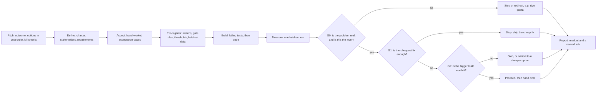

# fde-engagement-pattern: a forward-deployed engagement pattern, with one worked example

[](https://github.com/donbr/fde-engagement-pattern/actions/workflows/ci.yml)

**Forward Deployed Engineering (FDE)** is a consultative practice. A small group of engineers, either inside an organization or serving its clients, embeds with a business owner. Together they define the problem, prove a fix against numbers agreed in advance, and hand it over so it runs without them. The practice is older than AI engineering: it grew out of field engineering, solutions engineering and internal consulting groups. AI workloads raise the cost of building before measuring, but the discipline is the same.

This repo packages that practice as a reusable pattern: **define → accept → pre-register → build (tests first) → measure → decide → report.** The worked example is a load-shedding gateway, which does priority-based admission control in front of a shared LLM rate limit. The pattern is the files and the order they were written in, not the gateway. See [`PROCESS.md`](./PROCESS.md) for the timestamped order of work, [`AUDIT.md`](./AUDIT.md) to check those claims yourself in about 10 minutes, and [Reusing this pattern](#reusing-this-pattern) to apply it to your own use case.



Every gate can end the work, and each of those endings is a deliverable.

An earlier solution-first spike (not included in this repo) is the comparison point; see [What changed from the first pass](#what-changed-from-the-first-pass).

Step numbers (step 7, step 8, and so on) refer to rows in [`PROCESS.md`](./PROCESS.md). Steps 0–8 are the engagement; step 8 is its one amendment: after the first readout, a reviewer pointed out the gateway's visibility value, and the recommendation changed while the gate verdicts didn't.

The client is **hypothetical** (a regional health insurer) and the traffic is **synthetic**. Thresholds are **proposed**, for owners to sign.

## Key concepts

| Term | Meaning |
| --- | --- |
| **Option ladder** | The candidate fixes in cost order, from "do nothing" up. Each rung's data decides whether the next one is built. Here, the gateway is rung 3 of 5. |
| **Pre-registration** | Metrics, decision rules, thresholds and held-out data are fixed *before* the results exist. Any later change is logged with who approved it and why. |
| **Gate and stop rule** | A decision point (G0–G2 here) that returns PROCEED, NARROW or STOP. A missing threshold returns NOT DECIDABLE, never a default. |
| **Hypotheses H1–H9, metrics M1–M9** | Numbered so every gate and decision can cite them. Each hypothesis can come out false; each metric has a numerator, a denominator and a named owner. |
| **T_chat** | The example's target: the member-chat failure rate at peak that the business owner will accept. In general, the owner's target metric. |
| **Proposed vs signed** | The FDE proposes thresholds; the named owner signs them. Every verdict shows which kind it used. |
| **Shadow mode** | The control runs in the call path and records what it would have done, but blocks no known caller. The kill switch (`set_enforce(False)`) turns enforcement off and falls back to this mode, which is today's behaviour plus a record. |
| **Hold and settle** | Like a credit-card pre-authorization hold: authorize against an upfront token estimate, call the model, and capture actuals. Unused tokens are refunded; overruns are charged. |
| **Visibility vs enforcement** | Two values of the same component, judged separately. Visibility (metrics that didn't exist before) often justifies it before enforcement does. |
| **Acceptance (golden) cases** | A handful of cases whose expected outputs are worked out by hand from the requirements, before code exists, and never edited to fit the code. |
| **Who / What / Wow** | A one-line outcome statement: who benefits, what changes for them, and the result they'd notice. |
| **Decision log** | One row per decision, naming the option rejected and **what would change my mind**. |

## Where this sits in industry

The gateway in the worked example is what vendors call an **AI gateway** (or **LLM gateway**): a proxy in front of model providers. Inside it, it does **token-based rate limiting** plus **priority-based load shedding**, also called admission control by criticality. The engagement pattern doesn't depend on any of these products; the table maps the example's mechanisms to recognized practice.

| In this repo | Industry term | Reference |
| --- | --- | --- |
| Lower tiers are shed first (`reserves`) | Load shedding by request criticality | [Google SRE book, "Handling Overload"](https://sre.google/sre-book/handling-overload/) |
| A token budget enforced at the gateway | AI gateway token rate limiting | [Azure API Management `llm-token-limit`](https://learn.microsoft.com/en-us/azure/api-management/llm-token-limit-policy), [Kong AI Rate Limiting Advanced](https://developer.konghq.com/plugins/ai-rate-limiting-advanced/), [Envoy AI Gateway usage-based rate limiting](https://aigateway.envoyproxy.io/docs/capabilities/traffic/usage-based-ratelimiting) |
| A hold on the estimate, settled on actual tokens (`release`) | Estimate, then reconcile (hold and settle, like a credit-card pre-authorization hold) | [Azure API Management `llm-token-limit`, "Considerations for token counts and estimation"](https://learn.microsoft.com/en-us/azure/api-management/llm-token-limit-policy#considerations-for-token-counts-and-estimation): concurrent requests can temporarily exceed the limit, because actual usage is known only after the response |
| One bucket per process; a second replica needs shared counters | Distributed rate-limit counters | [Kong AI Rate Limiting Advanced](https://developer.konghq.com/plugins/ai-rate-limiting-advanced/): `local` counters diverge as nodes scale, `cluster` or `redis` share them. [`llm-token-limit`](https://learn.microsoft.com/en-us/azure/api-management/llm-token-limit-policy) counts per gateway and doesn't aggregate across regional gateways. |
| A protected share of capacity per tier | Priority levels with protected shares | [Kubernetes API Priority and Fairness](https://kubernetes.io/docs/concepts/cluster-administration/flow-control/) |
| Sheddable traffic for self-hosted model serving | Inference gateway with per-objective priority | [Gateway API Inference Extension](https://gateway-api-inference-extension.sigs.k8s.io/) ([CNCF deep dive](https://www.cncf.io/blog/2025/04/21/deep-dive-into-the-gateway-api-inference-extension/)) |
| Shadow mode before enforcement | Shadow or dark launch | — |
| Spend by department on actual tokens | FinOps showback | — |

The vendor limiters above key their limits by subscription, consumer, user or model. The per-tier reserve floor in this example is a policy built on top of that pattern; check current vendor docs before assuming it's built in.

## Layout

| Path | What |
| --- | --- |
| [`use_case/cxo-story.md`](./use_case/cxo-story.md) | The pitch, hypotheses, pre-registered metrics, gates with stop rules, and the **results log** |
| [`use_case/CHARTER.md`](./use_case/CHARTER.md) | Problem, success, first product: **a decision instrument** |
| [`use_case/requirements.md`](./use_case/requirements.md) | R1–R16 traced to stakeholder roles (R15 and R16 added in step 8), plus non-goals and anti-goals |
| [`use_case/stakeholders.md`](./use_case/stakeholders.md), [`ecosystem.md`](./use_case/ecosystem.md) | Carried over from the earlier spike, with changes |
| [`use_case/evals/`](./use_case/evals/) | Five acceptance cases, `PREREGISTRATION.md`, `thresholds.json`, `results/` |
| [`use_case/data/DATASHEET.md`](./use_case/data/DATASHEET.md) | Traffic spec, held-out seeds, what it can't validate |
| [`use_case/decisions.md`](./use_case/decisions.md) | 29 decisions by step, including what was **not** changed after the results, and the step 8 amendment |
| [`use_case/readout.md`](./use_case/readout.md) | The report: headline, what it does, numbers, cost, running it for real, risks, recommendation, handover, and the ask |
| [`solution/`](./solution/) | `fde_gateway`: shedder core, identity-aware shadow-mode gateway, options replay, gates, evaluation |
| [`AUDIT.md`](./AUDIT.md), [`scripts/check_history.py`](./scripts/check_history.py) | Each claim with the command that checks it; the pre-registration lock that CI runs on every push |

Needs Python 3.11+ and [uv](https://docs.astral.sh/uv/). From the repo root:

```bash
cd solution
uv run pytest                                # all checks, including snapshots of the saved results
uv run python -m fde_gateway.evaluate        # prints options and gates (saved copy: use_case/evals/results/2026-10-18_heldout.md)
uv run python -m fde_gateway.observe         # prints shadow metrics (saved copy: use_case/evals/results/2026-10-18_heldout_observability.md)
```

## What changed from the first pass

| | First pass (earlier spike, not included) | This pass |
| --- | --- | --- |
| **Order** | Build, run, tune, then write the charter and decisions | Charter → requirements → acceptance cases → pre-registration → failing tests → build → one held-out run → decisions → readout |
| **Nature of the product** | A tiered gateway | A **decision instrument** that compares five fixes in cost order, plus a gateway whose **first value is visibility** (shadow mode) and whose second, optional value is enforcement |
| **Complexity** | Shedder + department tags + replay | Adds identity-derived tiers, shadow mode, a kill switch, reason codes, provider failures attributed by workload, estimate accuracy, separate-limits and batch-lane options, quota sizing, and gate rules that give NOT DECIDABLE without a threshold |
| **Golden cases** | Read off the implementation | Worked out by hand from stakeholder requirements before code; passed on the first implementation, unedited |
| **Thresholds** | "< 5%" written after seeing 4.3% | Written before the held-out run; labelled *proposed*; none changed afterward |
| **Headline** | "Tiering cut member-chat failures from 19% to 4%" | "Moving one job cuts them from 18.3% to 5.8% with no new software. An observe-only gateway gives you numbers you don't have today, and those decide whether enforcing priority is ever worth it." |
| **Recommendation** | Proceed, narrowed (build and shadow-run the gateway) | Option 1 **plus the shadow gateway** for visibility; **defer enforcement** until real token shares and signed thresholds exist (step 8; step 7 had said "don't fund the gateway yet") |
| **Value** | Shows the mechanism works | Shows which fix is worth paying for, when to stop, and why the CxO can trust the answer. And it creates the metrics (attributed failures, peak share, estimate accuracy) that make those decisions possible on real traffic. |

## For the CxO conversation

Lead with `use_case/cxo-story.md` §1 and §2, then the results in §8. **The line to repeat:**

> "The cheapest fix gets most of the way. The gateway's first job is to show you numbers you don't have today: whose calls fail, who uses the peak, how far off the estimates are. Those numbers decide whether it should ever enforce anything, and I'll show you the answer either way."

### Answer any CxO question in six moves

1. **Their outcome first:** *"Member chats get turned away at peak. That's SLA misses and members choosing another plan."*
2. **One plain sentence on cause:** *"Batch work and live chat share one pipe, and batch fills it."*
3. **Options with trade-offs:** *"Buy more quota (fast, recurring cost), shift batch work off peak (zero software, immediate), or prioritize traffic via gateway (in-process library; sized after discovery)."*
4. **Your recommendation:** *"Move batch work first (Option 1). In simulation that fixes most of it (18.3% → 5.8% shed), while a shadow gateway observes live numbers to prove if tier enforcement is ever needed."*
5. **How we'll know:** *"First we make it visible in real time, on identifiers that can't be spoofed. Then a dry run. Then we decide together: one shared pipe with reserves, separate pipes, or both. Then we turn it on and compare."*
6. **What I need from you:** *"A named owner for the tiering table, and sign-off on what counts as critical."*

## Reusing this pattern

Replace the example in the order it was written. Each file feeds the next one.

| Order | Stage | Replace | What it must say before you move on |
| :---: | --- | --- | --- |
| 0 | Pitch | `use_case/cxo-story.md` §1–§7 | The outcome, the options in cost order, hypotheses that can come out false, metrics, and gates with stop rules. Written before any implementation. |
| 1 | Define | `use_case/CHARTER.md`, `stakeholders.md`, `requirements.md` | The problem in one sentence with no solution in it, who owns each number, and requirements traced to roles |
| 2 | Accept | `use_case/evals/golden.jsonl` | A handful of acceptance cases, with expected values worked out by hand from the requirements |
| 3 | Pre-register | `use_case/evals/PREREGISTRATION.md`, `thresholds.json`, `use_case/data/DATASHEET.md` | Metrics with denominators, gate rules and held-out data. Thresholds stay marked *proposed* until an owner signs them. |
| 4 | Build | `solution/tests/`, then `solution/src/` | Tests fail before the code exists and pass after it. Golden cases are not edited to fit the code. |
| 5 | Measure | `use_case/evals/results/` | One run on held-out data, saved as produced. If you regenerate it later, show that the counts and verdicts didn't change. |
| 6 | Decide | `use_case/decisions.md`, `cxo-story.md` §8 | A verdict at each gate, and what was *not* changed after the results |
| 7 | Report | `use_case/readout.md` | The report (headline, what it does, numbers, cost, running it for real, risks, recommendation, handover) and a named ask |

Log each step with a timestamp in `PROCESS.md`. The order is the evidence.

- Reuse the shape, not these numbers: cheapest fix first, thresholds set before the data, gates with stop rules, and whatever is left over sizes the spend.
- A stop verdict is a deliverable. Tell the sponsor that in the first meeting.

## License

MIT. See [`LICENSE`](./LICENSE).
