# Datasheet

*Written in step 3 of `../../PROCESS.md`, before the generator was written or run. (Mermaid Gantt visualization added as post-engagement documentation). This file is committed; the data is not. Traffic is generated in memory from the spec below.*

## What this data is

**Generated from:** the written description below. **No real records.**
**Bucket:** the starter scenario's: 1,000 tokens, refilling at 100 tokens/s.
**Window:** one 120-second open-enrollment morning peak per seed.
**Held-out seeds:** 200–219, never run by `evaluate` before step 5. The step 4 tests did touch seeds 200–204 for invariant checks; see the correction in `../../PROCESS.md`. The invariant tests now use seeds 300+; seeds 200–219 are run only to pin the saved results. The first-pass spike used seeds 0–19 and 100–119.

**Description:** member chat and claims summaries arrive all morning. The nightly policy refresh has spilled over and floods the first minute. In the "waves" mix, member chats also surge for 10 seconds three times in the window, as members respond to an enrollment email.

## Mixes

| Mix | Workload | Arrival | Token estimate | Window |
| --- | --- | --- | --- | --- |
| `baseline` | `member_chat` | Poisson 0.25/s | uniform 150–350 | 0–120 s |
| | `claims_summary` | Poisson 0.10/s | uniform 300–600 | 0–120 s |
| | `policy_refresh` | Poisson 1.00/s | uniform 400–800 | 0–60 s |
| `waves` | everything in `baseline`, plus extra `member_chat` | Poisson 1.00/s | uniform 150–350 | 20–30, 60–70, 100–110 s |

```mermaid
gantt
    title 120-Second Open Enrollment Peak Window
    dateFormat HH:mm:ss
    axisFormat %M:%S

    section Baseline (Spill-over)
    Policy Refresh Flood (1.0/s)    :crit, 00:00:00, 00:01:00
    Claims Processing (0.1/s)       :active, 00:00:00, 00:02:00
    Member Chat (0.25/s)            :00:00:00, 00:02:00

    section Waves (Chat Bursts)
    Wave 1 Surge (20-30s, 1.0/s)    :crit, 00:00:20, 00:00:30
    Wave 2 Surge (60-70s, 1.0/s)    :crit, 00:01:00, 00:01:10
    Wave 3 Surge (100-110s, 1.0/s)  :crit, 00:01:40, 00:01:50
    Baseline Background Load        :active, 00:00:00, 00:02:00
```

**For every call:**
- **Actual vs estimate:** actual tokens are uniform between 70% and 105% of the estimate, so some calls overrun.
- **Latency:** admit to settle takes a fixed 2 s.
- **Identity:** each call carries its workload's caller identity (`chat-frontend`, `claims-worker`, `refresh-job`).
- **Spoofing (M8 only):** in the spoofing replay, every `claims-worker` call also claims `member_chat`, the worst case.

**Decisions are made on `baseline`. `waves` is a pre-registered sensitivity check:** if its verdicts differ, the readout must say so.

**Where `baseline` came from:** it's the first-pass spike's mix, chosen before any stakeholder requirement existed. `waves` was added in step 3, because the first datasheet said real traffic is probably burstier.

## What it can validate

- How each option behaves relative to the others under these assumed mixes, on seeds never used to choose anything.
- Whether a gate rule produces the verdict its definition says it should.
- That the gateway's accounting (shadow mode, settlement, showback) stays consistent across thousands of calls.

## What it cannot validate

- **Real arrival rates, burstiness or sizes.** I chose every parameter.
- **Retries.** A shed call is gone. Real callers retry, which lowers the impact per shed and raises the load.
- **The provider's real limiter.** A token bucket approximates a per-minute account limit.
- **The batch lane's turnaround.** Option 1 treats the refresh as leaving the live limit; whether it's fresh enough is the Content Operations owner's question.
- **Whether the proposed thresholds are right.** Only the named owners can say that.

## What it must never be compared against

The client's provider usage and 429 logs, and the shadow run during a real peak. Those are the ground truth. No number from this data is a baseline or forecast for a real system.

## Leakage check

- [x] No real record was used as a seed.
- [x] No real entity names, IDs, or identifiers appear.
- [x] No distinctive internal formats that would identify a firm.
- [x] Rare categories were generated, not copied (there are none).
