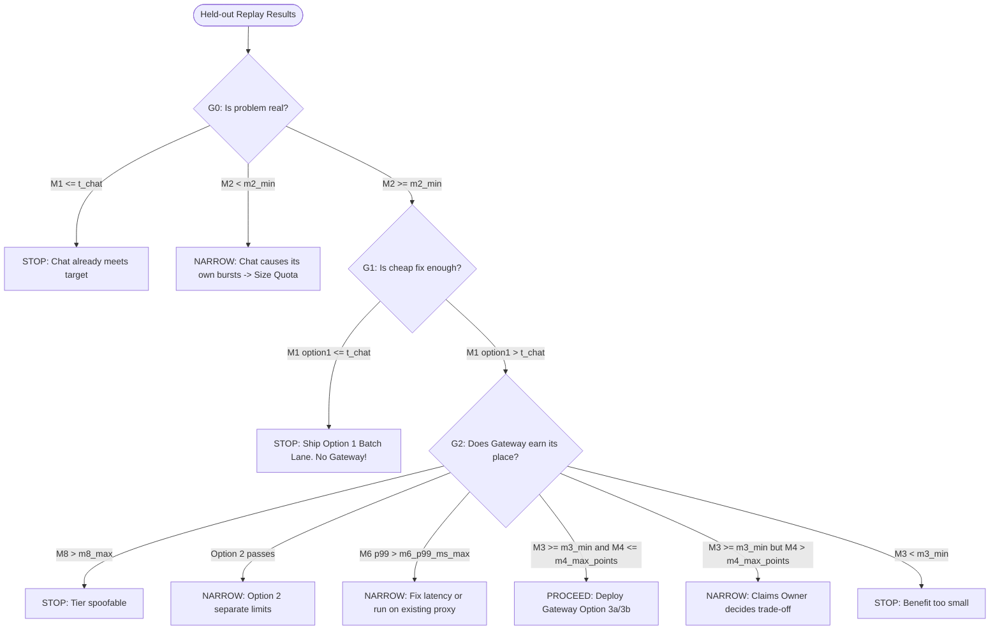

# Pre-registration: how the options are judged

> [!IMPORTANT]
> **What is this document?**
> Borrowed from clinical trial methodology, this pre-registration protocol freezes the evaluation metrics, candidate options, and gate decision rules **before** running held-out traffic or writing production code.
>
> * **The Core Question:** Does software earn its place over zero-cost operational fixes?
> * **The Decision Ladder ($G_0 \to G_3$):** Evaluated strictly in order. $G_0$ tests if the bottleneck is real; $G_1$ halts the gateway program if the zero-software fix (Option 1) solves the SLA; $G_2$ audits cross-stakeholder trade-offs (Member chat vs. Claims vs. Infosec vs. FinOps); $G_3$ requires live enforcement.
> * **Unbiased Reporting Pledge:** As committed in [§ What I commit to reporting](#what-i-commit-to-reporting-regardless-of-outcome), all options, sensitivity edges, and divergent verdicts are reported even if they render the gateway redundant.
> * **Stakeholder Mappings & Rationale:** For stakeholder-by-stakeholder veto criteria and evidence sources, see [`evals/README.md`](README.md). For business hypotheses and cost baselines, see [`cxo-story.md`](../cxo-story.md).

*Written in step 3 of `../../PROCESS.md`, before any code and before any held-out run. It expands `../cxo-story.md` §3–§5 into exact definitions. The thresholds are in `thresholds.json`.*

## Options, as configured for the replay

Every option sees the same arrivals for a given seed and mix. The bucket is shared at 1,000 tokens and 100/s unless stated.

| Option | Configuration |
| --- | --- |
| `today` (option 0) | Full mix, one shared bucket, all reserves 0: first come, first served |
| `option1` | `policy_refresh` removed from live traffic (moved to the batch lane); shared bucket, reserves 0 |
| `option2` | `option1`, plus **separate limits**: chat gets 600 tokens at 60/s, claims 400 at 40/s. The split follows expected token demand from the datasheet (chat 62.5/s, claims 45/s, roughly 58:42, rounded to 60:40) |
| `option3a` | `option1`, plus the **tiered gateway** with the starter reserves: CRITICAL 0, STANDARD 0.10, DEFERRABLE 0.40 |
| `option3b` | `option1`, plus the tiered gateway with STANDARD at 0.35 (the floor equals the largest chat estimate, 350). *From the first-pass spike; disclosed.* |
| `chat_alone` | Member chat only, shared bucket, reserves 0 |

## Metrics

All rates are pooled over the 20 held-out seeds: total count ÷ total count. The worst single window is reported next to each pooled rate.

| Metric | Definition |
| --- | --- |
| **M1** | Member chats shed ÷ member chats offered, per option |
| **M2** | (M1 shed count under `today` − shed count under `chat_alone`) ÷ shed count under `today` |
| **M3**, per candidate (`option2`, `option3a`, `option3b`) | (Chats shed under `option1` − chats shed under the candidate) ÷ chats shed under `option1`. Undefined if `option1` sheds none, but G1 has stopped by then. |
| **M4**, per candidate | (Claims shed rate under the candidate − claims shed rate under `option1`) × 100, in percentage points |
| **M5** | M1 under `chat_alone`. **Quota scale:** the smallest multiplier in 1.0, 1.1, …, 2.0, applied to both capacity and refill, at which M1 ≤ `t_chat`. Reported for `option1` and for the recommended option. |
| **M6** | p99 wall time of a single gateway `submit`, in milliseconds, over every submit in the `option3a` and `option3b` replays, on the machine that ran it |
| **M8** | In the spoofing replay of `option3a` (every claims call claims `member_chat`): the number of calls from a non-chat identity that were decided at CRITICAL |

## Decision rules

Gates are evaluated in order. A gate is evaluated only if the previous one said PROCEED; otherwise it reports NOT REACHED. A threshold the rule needs that's missing gives NOT DECIDABLE.

| Gate | Rule |
| --- | --- |
| **G0** | STOP if `M1(today) ≤ t_chat`. Otherwise PROCEED if `M2 ≥ m2_min`. Otherwise NARROW: go to quota sizing. |
| **G1** | STOP (the gateway program) if `M1(option1) ≤ t_chat`. Otherwise PROCEED. |
| **G2** | A candidate *passes* if `M3 ≥ m3_min` and `M4 ≤ m4_max_points`. Checked in this order: |
| | 1. STOP if `M8 > m8_max`: a tier can be spoofed. |
| | 2. NARROW to `option2` if `option2` passes. It's cheaper, needs no gateway, and is preferred when it meets the same bar. |
| | 3. NARROW if `M6 > m6_p99_ms_max`: fix latency, or run as a policy on an existing gateway. |
| | 4. PROCEED with `option3a` if it passes. Otherwise PROCEED with `option3b` if it passes. |
| | 5. NARROW if any candidate meets `M3` but not `M4`: the benefit is real, Claims' cost is over its limit, and the Claims owner decides. |
| | 6. Otherwise STOP: the gateway's benefit is too small. |
| **G3** | Not reachable in simulation. It needs a real enforcement period. |

Each verdict carries the reason that produced it, and the status (`proposed` or `signed`) of every threshold it used.

## What I commit to reporting regardless of outcome

- Every metric for every option on both mixes, including any that make the gateway look unnecessary.
- The `waves` verdicts next to the `baseline` verdicts, and whether they agree.
- That the thresholds are proposed, not signed, and what each observed value would need to be for the verdict to flip.
