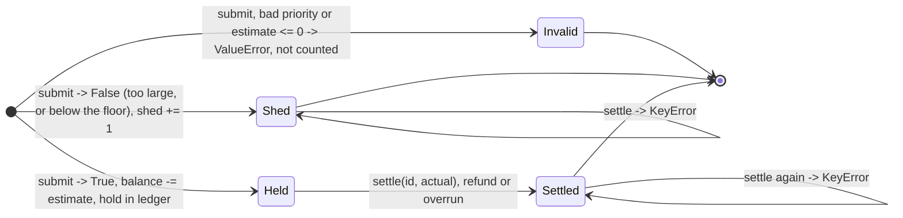

# Evals

*Written in steps 2–3 of `../../PROCESS.md`, before any code.*

## Stakeholder Governance: Which Tests Clear Which Role

The evaluation suite and acceptance cases are not generic benchmarks; they are **executable governance contracts** where each stakeholder with sign-off or veto power has specific clearing evidence:

```text
                                  ┌───► 1. CISO / Privacy (Identity & Anti-Spoofing: R5, M8)
                                  ├───► 2. FinOps / CFO (Showback & Overruns: R10, M5)
[ Acceptance Tests & Gate Suite ] ┼───► 3. SRE / Platform (Shadow Mode & Kill Switch: R7, M6)
                                  ├───► 4. Member Services Ops (Chat SLA: R1, T_chat)
                                  ├───► 5. Claims Ops (Trade-off Cost: M4, G2)
                                  └───► 6. Sponsor (CIO/COO) (Fiduciary Stop Rule: R12, G1)
```

1. **CISO / Privacy Officer (Veto):**
   - *Concern:* Blast radius, payload inspection, tier spoofing.
   - *Clearing evidence:* `tier_comes_from_identity` (Case 2, R5); metadata-only decision records (R6); spoofing sensor test in `test_mutation_gaps.py` ($M_8 = 0$).
2. **FinOps Lead / CFO Delegate (Veto via procurement):**
   - *Concern:* True financial showback, paying for unrun calls or estimation padding.
   - *Clearing evidence:* `showback_charges_what_ran` (Case 4, R10); overrun balance tests (holds settle on actuals; shed calls cost $0); quota scaling ($M_5$).
3. **SRE / Platform Engineering Lead (Readiness):**
   - *Concern:* Outage blast radius, added latency, kill-switch reliability.
   - *Clearing evidence:* `shadow_mode_and_kill_switch` (Case 3, R7); latency p99 $\le 1$ ms test ($M_6$); clock-drift resilience; `KeyError` idempotency guards.
4. **Member Services Operations Manager (Problem Owner):**
   - *Concern:* Live member chat availability during peak enrollment.
   - *Clearing evidence:* `member_chat_survives_refresh_flood` (Case 1, R1); gate boundary tests on $M_1 \le T_{\text{chat}}$ and $M_3 \ge 50\%$.
5. **Claims Operations Manager (Cross-Department Partner):**
   - *Concern:* The sacrifice of claims summaries to protect member chat.
   - *Clearing evidence:* Gate 2 boundary tests ($M_4 \le 15$ pts); if the trade-off exceeds limits, G2 returns **NARROW**, keeping the decision in Claims' hands.
6. **Sponsor (CIO or COO) (Go / No-Go):**
   - *Concern:* Funding unnecessary software when an operational fix suffices.
   - *Clearing evidence:* `gate_stops_when_cheap_fix_suffices` (Case 5, R12); Gate 1 returns **STOP** when Option 1 meets $T_{\text{chat}}$, halting further build spend.

## `golden.jsonl`: stakeholder acceptance cases

Five cases, one per requirement that decides the design. The expected values were worked out by hand from the requirement. They are **not** read off an implementation (none existed yet).

| Case | Stakeholder | Requirement | What it pins down |
| --- | --- | --- | --- |
| `member_chat_survives_refresh_flood` | Member Services ops manager | R1 | Each lower tier stops at its floor; chat spends what's left |
| `tier_comes_from_identity` | CISO | R5 | A claimed tier is ignored and flagged; an unknown caller is rejected (**the escalate case**) |
| `shadow_mode_and_kill_switch` | SRE lead | R7 | Shadow mode never blocks a known caller; enforcement can be switched on and off mid-run |
| `showback_charges_what_ran` | FinOps lead | R10 | Spend is charged on actual tokens, including shadow-allowed would-sheds; blocked calls cost nothing |
| `gate_stops_when_cheap_fix_suffices` | Sponsor | R12 | **The stop case**: the instrument recommends against building the gateway when option 1 meets the target |

### Format

Each line is `{"input", "output", "why"}`.

**Gateway cases** have these inputs: `config`, `identities` (caller → workload), the initial `enforce` flag, and `steps`. Each step is one of:
- `submit`: caller, id, token_estimate, and optionally `claimed_workload`;
- `settle`: id, token_actual;
- `set_enforce`.

Each step's expected result is one of:
- a dict, checked on its listed keys only (`allowed`, `reason`, `workload`, `spoof_attempt`, `enforced`);
- `null`;
- an exception name.

`showback` is checked at the end.

### Request state machine

The steps in each golden gateway case exercise the request transitions and idempotency guards:



**The gate case** gives `thresholds` and `metrics`, and expects a verdict for each gate.

Both mixes run against the same workload table: `member_chat` → Member Services, CRITICAL; `claims_summary` → Claims, STANDARD; `policy_refresh` → Content Operations, DEFERRABLE.

## `thresholds.json`: pre-registered decision thresholds

Written in step 3, before any replay ran on the held-out seeds. Each threshold records:
- its value;
- the owner who must sign it;
- its status (`proposed` until that owner signs);
- the reason for the proposed value.

Every verdict the evaluation reports carries the status of the thresholds it used. **A missing threshold produces NOT DECIDABLE, never a default.**

Changing a value after step 5 requires a row in `../decisions.md` saying what changed, why, and who approved it.
